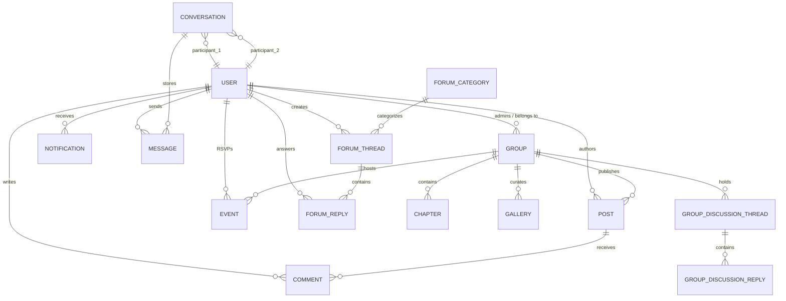

# IIEST Campus Connect: Deep Features Specification & Architecture Report

---

## 1. Executive Context: Why This Project Was Created

### 1.1 The Genesis & Core Problem Statement

At Indian Institute of Engineering Science and Technology (IIEST), Shibpur—a premier 160+ year-old historical institute spread across 125+ acres—campus life is vibrant, multi-disciplinary, and intensely active. However, the **digital infrastructure connecting its 4,000+ students, 16+ departments, and 30+ societies and clubs has historically been broken, fragmented, and ephemeral**.

### 1.2 The 5 Core Pain Points Solved

1. **The Ephemeral Information Void (The WhatsApp Trap):**
   - Crucial campus announcements, society recruitment drives, hackathon notices, and placement tips are buried in hundreds of unofficial WhatsApp batch groups.
   - Once a student graduates or messages roll past, institutional knowledge is lost forever. There is no searchable, indexed archive.
2. **Siloed Departmental Ecosystems:**
   - Engineering departments (CSE, IT, Electrical, Mechanical, Civil, Metallurgy, Mining, Aerospace, Architecture) operate as isolated islands.
   - A mechanical student building an IoT rover cannot easily discover a 2nd-year CSE student skilled in computer vision or embedded systems.
3. **The Superficial Identity Paradox:**
   - **LinkedIn** is too corporate, formal, and generic; it doesn't capture college hostel life, club positions, departmental projects, or campus achievements.
   - **Instagram** is entertainment-focused and superficial; it cannot serve as a verifiable technical portfolio or collaborative platform.
   - Students needed a **verified campus identity** rooted in their academic Roll ID, showcasing technical skills, verified club roles, and student projects.
4. **Club & Chapter Management Chaos:**
   - Societies (Robodarshan, CodeIIEST, Debating Society, Euphony, Les Creatives, Catharsis, Reflexobeta, SCAGE, etc.) manage members through ad-hoc Google Forms, unofficial spreadsheets, and scattered Instagram stories.
   - There was no unified portal for club announcements, gallery archives, hierarchical chapter leadership, and internal discussions.
5. **Campus Spatial & Resource Disconnect:**
   - The sprawling 125-acre campus (historic Main Building, Clock Tower, 1st to 10th Hostels, Wolfenden Hall, Richardson Hall, Sen Hall, Netaji Bhavan, Oval grounds, Lords ground, hospital, canteens) is bewildering to freshers and visitors.
   - Vital physical locations lacked an interactive digital guide paired with student-curated advice.

---

## 2. Exhaustive Feature-by-Feature Specifications

### Feature Module 1: Institutional Identity & Authentication System

* **Primary Model:** `user.model.js`, `otp.model.js`
- **Authentication Strategy:** Passport.js Local Strategy with normalized Roll ID primary key (`normalizeRollId` middleware).

#### Deep Mechanics & Rules

1. **Roll ID as Primary Unique Identifier:**
   - Unlike generic web apps using emails or handles, identity is strictly tied to IIEST Roll ID format (e.g., `2021CSB042`, `2022ITB015`).
   - Roll ID parsing deterministically reveals: **Admission Year, Department Code, Degree Level (B.Tech, M.Tech, Ph.D.), and Roll Index**.
   - Input normalization automatically strips spaces and converts to uppercase before reaching controller logic.
2. **Multi-Factor Password Recovery Flow:**
   - Integrated Nodemailer service with crypto-token generation (`resetPasswordToken`, `resetPasswordExpires`).
   - OTP verification sub-flow (`otp.model.js`) ensuring account recovery without administrative intervention.
3. **Role-Based Access Control (RBAC):**
   - Three distinct authority tiers:
     - `student`: Standard authenticated peer access.
     - `groupAdmin`: Elevated permissions over assigned club/society spaces.
     - `siteAdmin`: Super-administrative governance over the entire platform, moderation queue, and user roles.

---

### Feature Module 2: The Living Student Portfolio (User Profiles)

* **Primary Model:** `user.model.js` (Embedded Subdocument Schemas)

#### Deep Mechanics & Components

1. **Academic Identity Header:**
   - Dual-image banner: Cloudinary-backed circular avatar (`profilePicture`) and wide cover banner (`backgroundImage`).
   - Department badge, expected graduation year, personalized bio, and favorite quote.
2. **Structured Technical Showcase:**
   - **Skills Array:** Self-curated technical and soft skills with proficiency tags.
   - **Projects Subdocument:** Project title, live URL, GitHub repository link, description, and preview screenshot.
   - **Achievements Subdocument:** Verified awards, hackathon ranks, scholarship honors, and certificate document uploads.
   - **External Handles Directory:** Direct links to Codeforces, LeetCode, GitHub, LinkedIn, Kaggle, Behance.
3. **Peer Social Graph:**
   - Asymmetric Follow/Unfollow mechanism (`followers: [ObjectId]`, `following: [ObjectId]`).
   - Generates personalized social activity feed based on followed peers and joined societies.

---

### Feature Module 3: Central Social Feed & Post Lifecycle

* **Primary Models:** `post.model.js`, `comment.model.js`

#### Deep Mechanics & Lifecycle

1. **Content Composition:**
   - Rich text descriptions with tag support (`#hackathon`, `#placement`, `#campuslife`).
   - Multi-image upload engine (up to 5 Cloudinary-hosted images per post) with automatic thumbnail transformation.
2. **Contextual Author Attribution:**
   - A post can be published under 3 distinct identities:
     - **Personal Post:** Authored by student (`author: user._id`).
     - **Society/Club Post:** Authored on behalf of a club (`groupAuthor: group._id`).
     - **Chapter Post:** Authored by a departmental chapter (`chapterAuthor: chapter._id`).
3. **Engagement & Social Validation:**
   - Idempotent Like/Unlike toggle with real-time tally update.
   - Image carousel preview with modal expansion and keyboard navigation.
4. **Nested Threaded Comments:**
   - Multi-tier recursive commenting architecture.
   - Comment author permissions: only comment author or post owner can delete/moderate.
   - AJAX-powered comment submission preventing full-page reload.

---

### Feature Module 4: Clubs, Societies & Departmental Chapters

* **Primary Models:** `group.model.js`, `chapter.model.js`, `userGroupActivity.model.js`

#### Deep Mechanics

1. **Categorized Community Hubs:**
   - Strict categorization: `Coding`, `Music`, `Dance`, `Art`, `Departmental`, `Sports`, `Literary`, `Other`.
   - URL slugs auto-generated from group names for SEO-friendly and clean permalinks (`/groups/codeiiest`, `/groups/robodarshan`).
2. **Hierarchical Governance Structure:**
   - Multi-admin governance (`admins: [ObjectId]`).
   - Member roster management (`members: [ObjectId]`) with role delegation.
3. **Sub-Chapter Delegation:**
   - Large societies can spawn specialized chapters (e.g., CodeIIEST CP Chapter, Web Dev Chapter, AI/ML Chapter).
   - Chapters maintain independent coordinators, member subsets, and dedicated announcement boards.
4. **Audit Trail & Activity Logging:**
   - `userGroupActivity.model.js` records join dates, role transitions, post contributions, and leadership terms.

---

### Feature Module 5: Dedicated Group Discussion Forums

* **Primary Models:** `groupDiscussionThread.model.js`, `groupDiscussionReply.model.js`

#### Deep Mechanics

1. **Internal Club Working Spaces:**
   - Unlike public posts, Group Discussions are focused, long-form discussion threads reserved for club initiatives, event planning, and internal workshops.
2. **Rich Content Formatting:**
   - Integrated Quill Rich Text Editor supporting code snippets, lists, blockquotes, and inline image uploads (`/api/discussions/upload-image`).
3. **Discussion Thread Moderation:**
   - Pinning important threads to top.
   - Locking discussions once an initiative or recruitment cycle concludes.

---

### Feature Module 6: Campus-Wide Q&A Forum & Knowledge Base

* **Primary Models:** `forumCategory.model.js`, `forumThread.model.js`, `forumReply.model.js`

#### Deep Mechanics

1. **Structured Categorization:**
   - Topics split into official categories: `Academics & Curriculum`, `Hostel & Campus Facilities`, `Placements & Internships`, `Coding & Hackathons`, `General Campus Life`.
2. **Voting & Community Moderation:**
   - Net-vote score counter with upvote/downvote mechanics on both questions and answers.
   - Answer acceptance mechanism: Thread creator can designate a reply as the **"Accepted / Best Answer"**, pinning it to the top.
3. **Search & Tag Discovery:**
   - MongoDB text index matching across thread titles, descriptions, and category tags.

---

### Feature Module 7: Real-Time Direct Messaging System (`/messages`)

* **Primary Models:** `conversation.model.js`, `message.model.js`

#### Deep Mechanics

1. **Two-Pane Responsive Messenger Interface:**
   - **Left Pane:** Sorted list of active conversations with unread message badges, avatar, last message preview, and relative time (`timeago.js`).
   - **Right Pane:** Scrollable message transcript, real-time message bubbles, delivery state, and auto-scroll to bottom.
2. **Socket.IO Real-Time Dispatch:**
   - Private conversation rooms (`conversation:CONV_ID`).
   - Optimistic message rendering on sender side while background WebSocket payload dispatches.
   - Fallback REST API endpoints (`/api/messages`) ensuring deliverability if WebSocket connection drops.

---

### Feature Module 8: Interactive Leaflet Campus Map

* **Primary Model:** `campusLocation.model.js`
- **Library:** Leaflet.js 1.9.4 with custom tile layering and responsive GPS coordinate pins.

#### Deep Mechanics

1. **Geospatial Directory:**
   - Latitude, Longitude, location title, description, category (`Hostel`, `Academic`, `Admin`, `Canteen`, `Sports`, `Medical`), and landmark photograph.
2. **Interactive Campus Navigation:**
   - Click-to-focus camera pan, custom SVG map pin markers colored by category.
   - Rich popup modal displaying location history, opening hours, and contact details.

---

### Feature Module 9: Campus Polls & Live Engagement

* **Primary Model:** `poll.model.js`

#### Deep Mechanics

1. **Democratic Campus Feedback:**
   - Single-choice and multi-choice polls with expiration timestamps.
2. **Real-Time Visual Breakdown:**
   - Instant calculation of percentage bars upon vote submission.
   - Duplicate vote prevention via user ID tracking array.

---

### Feature Module 10: Event Management & RSVP System

* **Primary Model:** `event.model.js`

#### Deep Mechanics

1. **Lifecycle Management:**
   - Event creation by club admins: title, banner image, date, time, physical location / virtual link, description.
2. **Social Attendance (RSVP):**
   - One-click RSVP (`attendees: [ObjectId]`) with attendee count tally.
   - Filterable view: `Upcoming Events`, `Past Archive`, `My Attending Events`.

---

### Feature Module 11: Real-Time Notification Center

* **Primary Model:** `notification.model.js`

#### Deep Mechanics

1. **Multicast Notification Triggers:**
   - Triggers on: Post likes, comment replies, forum answer accepted, club event announced, direct messages received.
2. **Live Counter & Read Tracking:**
   - Unread badge counter in main navigation bar updating via Socket.IO without page reload.
   - Bulk "Mark All As Read" and individual notification dismissal.

---

### Feature Module 12: Super-Admin Governance Dashboard (`/sm/admin`)

* **Primary Controller:** `admin.controller.js`

#### Deep Mechanics

1. **Campus Moderation Suite:**
   - User directory auditing, role upgrades/downgrades (`student` <-> `groupAdmin` <-> `siteAdmin`).
   - Club creation approval and administrative assignment.
   - Site-wide broadcast notification engine for urgent campus announcements.

---

## 3. Complete Data Architecture & Entity Relationship Diagram

---

## 4. Summary Matrix of All 19 Database Models

| # | Model Name | Primary Responsibility | Key Fields |
| --- | --- | --- | --- |
| 1 | `user.model.js` | Core student identity & portfolio | `rollId`, `email`, `department`, `skills`, `projects`, `achievements`, `followers` |
| 2 | `post.model.js` | Social feed publication | `content`, `images[]`, `author`, `groupAuthor`, `likes[]`, `tags[]` |
| 3 | `comment.model.js` | Threaded post commentary | `content`, `author`, `post`, `parentComment`, `likes[]` |
| 4 | `group.model.js` | Club & society registry | `name`, `slug`, `groupType`, `admins[]`, `members[]`, `logo` |
| 5 | `chapter.model.js` | Departmental / sub-club units | `name`, `parentGroup`, `coordinators[]`, `members[]` |
| 6 | `groupDiscussionThread.model.js` | Internal society working thread | `title`, `content`, `group`, `author`, `isPinned`, `isLocked` |
| 7 | `groupDiscussionReply.model.js` | Replies in internal society threads | `content`, `thread`, `author` |
| 8 | `forumCategory.model.js` | High-level Q&A taxonomy | `name`, `slug`, `description`, `icon` |
| 9 | `forumThread.model.js` | Public campus Q&A question | `title`, `content`, `category`, `author`, `upvotes[]`, `downvotes[]`, `acceptedReply` |
| 10 | `forumReply.model.js` | Answers in campus forum | `content`, `thread`, `author`, `upvotes[]`, `downvotes[]`, `isAccepted` |
| 11 | `campusLocation.model.js` | GPS coordinates & campus guide | `title`, `coordinates[lat, lng]`, `category`, `description`, `image` |
| 12 | `conversation.model.js` | 1-on-1 direct messaging container | `participants[2]`, `lastMessage`, `updatedAt` |
| 13 | `message.model.js` | Individual chat message | `conversation`, `sender`, `text`, `readStatus`, `createdAt` |
| 14 | `poll.model.js` | Campus voting and feedback | `question`, `options[{text, votes[]}]`, `author`, `expiresAt` |
| 15 | `event.model.js` | Club events & workshops | `title`, `eventDate`, `location`, `bannerImage`, `hostedByGroup`, `attendees[]` |
| 16 | `gallery.model.js` | Photo archives for societies | `group`, `images[]`, `uploadedBy` |
| 17 | `notification.model.js` | Real-time push & inbox alerts | `recipient`, `sender`, `type`, `link`, `read`, `createdAt` |
| 18 | `userGroupActivity.model.js` | Historical activity logs | `user`, `group`, `actionType`, `timestamp` |
| 19 | `otp.model.js` | Password reset security tokens | `email`, `otp`, `expiresAt` |
