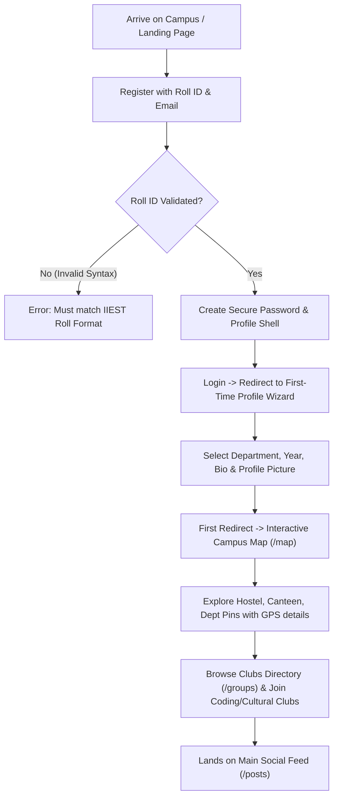
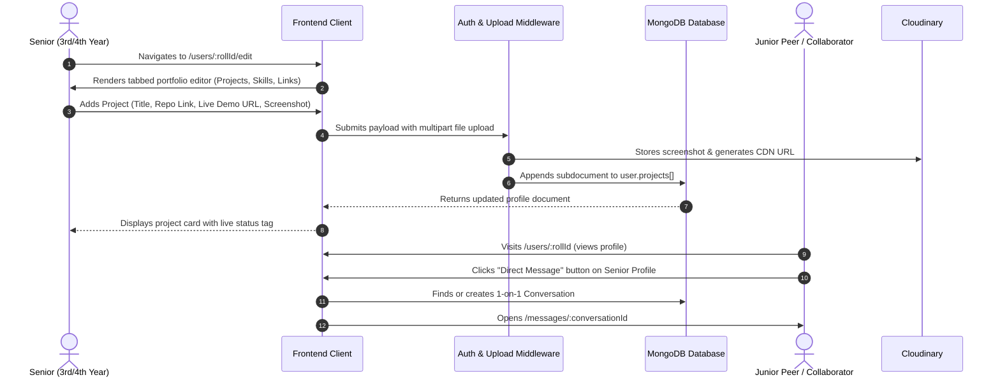
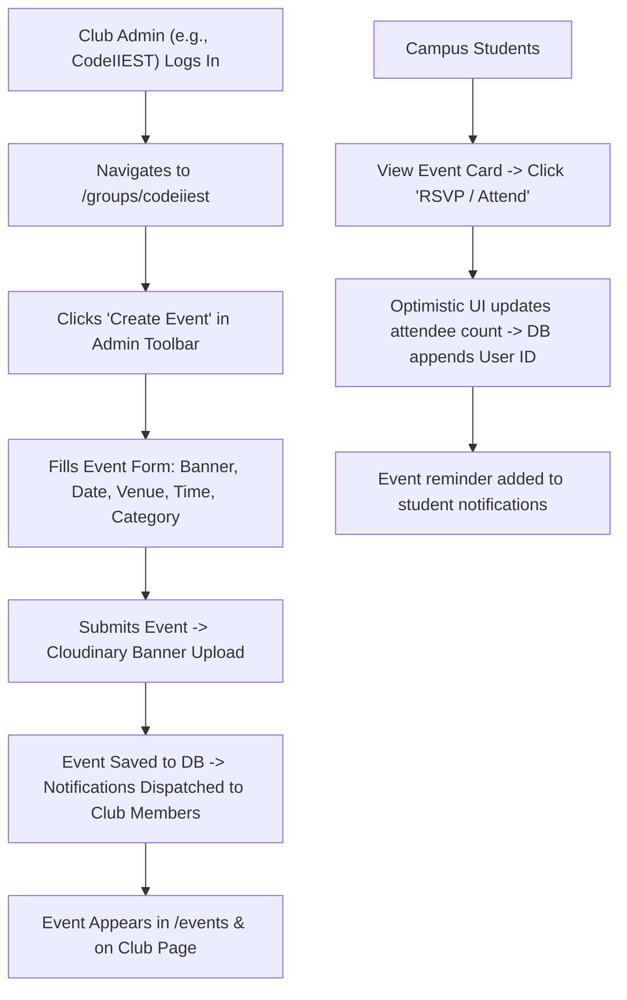
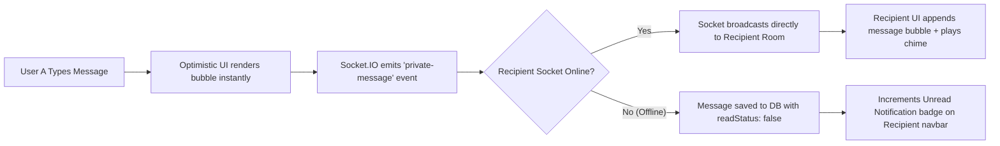
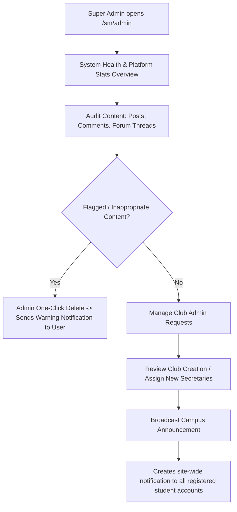

# IIEST Campus Connect: End-to-End User Flows & Lifecycle Specifications

---

## 1. Persona Matrix & Core Archetypes

To engineer an intuitive, human-centered platform, Campus Connect caters to 5 primary campus personas:

```
┌────────────────────────────────────────────────────────────────────────┐
│                        CAMPUS CONNECT PERSONAS                         │
├────────────────────┬────────────────────┬──────────────────────────────┤
│ 1. The Fresher     │ First-year student │ Needs orientation, campus    │
│                    │ (B.Tech / M.Tech)  │ map, club discovery, Q&A     │
├────────────────────┼────────────────────┼──────────────────────────────┤
│ 2. The Senior /    │ 3rd/4th-year       │ Needs project showcase, peer │
│    Pre-Final Year  │ placement aspirant │ mentoring, hackathon teams   │
├────────────────────┼────────────────────┼──────────────────────────────┤
│ 3. The Club Lead   │ Society Secretary  │ Needs event management,      │
│                    │ / Core Member      │ recruitment, club forums     │
├────────────────────┼────────────────────┼──────────────────────────────┤
│ 4. The General     │ Active peer        │ Needs daily social feed,     │
│    Campus Peer     │ across departments │ direct chat, campus polls    │
├────────────────────┼────────────────────┼──────────────────────────────┤
│ 5. Super Admin /   │ Platform maintainer│ Moderation, user audit,      │
│    Campus Moderator│ / faculty liaison  │ broadcasts, club approvals   │
└────────────────────┴────────────────────┴──────────────────────────────┘
```

---

## 2. Exhaustive Step-by-Step User Lifecycles

### Flow 1: The Fresher Onboarding & Spatial Discovery Journey
* **Goal:** Zero-friction orientation, establishing campus identity, and physical campus discovery.



#### Detailed Steps & Edge Cases:
1. **Registration:**
   - User inputs `rollId` (e.g., `2024CSB089`), `email` (preferably institutional `@iiest.ac.in` or Gmail), and `password`.
   - **Edge Case - Duplicate Roll ID:** System checks MongoDB index; if exists, flash error: *"An account with this Roll ID is already registered. Use Forgot Password if you lost access."*
2. **First-Time Setup Wizard:**
   - User uploads profile photo via Cloudinary widget. If skipped, generates an SVG avatar with student initials.
   - User selects Department (e.g. *Computer Science and Technology*) and Batch (*2024 - 2028*).
3. **Campus Navigation Flow:**
   - Fresher opens `/map`. The Leaflet canvas initializes centered on IIEST Shibpur coordinates (`22.5555° N, 88.3065° E`).
   - Filters pins by: `Hostels` (Wolfenden, Richardson, Sen, Macdonald, Hostels 7-11), `Canteens` (Bina, Cafe, Oval Canteen), `Academic Blocks` (Main Building, Slater Hall, CST/IT building).
   - Clicking a pin opens a drawer with walking directions, historical notes, and operational hours.

---

### Flow 2: The Senior Project Showcase & Peer Mentorship Lifecycle
* **Goal:** Building a professional living portfolio and fostering cross-departmental collaboration.



#### Detailed Steps & Edge Cases:
1. **Portfolio Expansion:**
   - Senior adds external handles: Codeforces rating link, LeetCode profile, GitHub repository links.
   - Senior adds Achievements: Uploads certificate PDFs/images with credential validation.
2. **Mentorship Inquiry:**
   - Junior browses `/search?q=machine+learning` or `/posts/tags?tag=placement`.
   - Discovers Senior's post or profile; clicks the **"Send Message"** button.
   - If conversation already exists between the two users, opens the thread seamlessly; otherwise initializes a new `Conversation` document.

---

### Flow 3: The Society Secretary Event & Announcement Cycle
* **Goal:** Hosting an official society workshop or recruitment drive with real-time RSVPs.



#### Detailed Steps & Edge Cases:
1. **Club Scope Validation:**
   - Only users whose IDs match `group.admins[]` or `siteAdmin` can see the "Create Event", "Edit Club", and "Upload to Gallery" controls.
2. **RSVP Idempotency:**
   - Clicking RSVP twice un-registers the attendee (toggle behavior) without causing race conditions or duplicate entries in `event.attendees[]`.
3. **Photo Archive Archival:**
   - Post-event, the Secretary uploads up to 20 high-res photos to `/groups/:slug/gallery` to preserve the event history permanently.

---

### Flow 4: The Campus Forum Q&A & Upvote Community Cycle
* **Goal:** Fast, reliable answers to college doubts without WhatsApp clutter.

```mermaid
sequenceDiagram
    autonumber
    actor Asker as Student Asking Question
    participant Forum as Forum Engine
    participant DB as MongoDB
    actor Contributor as Peer / Senior Answering
    actor Community as Browsing Students

    Asker->>Forum: Creates thread in category "Placements & Internships"
    Forum->>DB: Stores thread with tags [#internship, #oncampus, #CSE]
    Contributor->>Forum: Browses category -> types answer in Quill editor
    Contributor->>DB: Submits answer -> appends to forumReply collection
    Forum->>Asker: Sends notification: "Someone answered your question!"
    Community->>Forum: Upvotes answer (score +1 in real-time)
    Asker->>Forum: Clicks "Mark as Accepted / Best Answer"
    Forum->>DB: Sets reply.isAccepted = true; thread.acceptedReply = replyId
    Forum-->>Community: Pins accepted answer with green checkmark banner
```

---

### Flow 5: The Real-Time Direct Messaging Flow (`/messages`)
* **Goal:** Low-latency private peer communication.



---

### Flow 6: Super-Admin Moderation & Emergency Broadcast Flow
* **Goal:** Content safety, college governance, and crisis management.



---

## 3. Core State Machines & Lifecycles

### 3.1 Post Lifecycle State Machine
```
[DRAFT IN TEXTAREA]
       │ (User clicks "Publish" + Cloudinary upload)
       ▼
  [PUBLISHED] ◄────────────────────────────────┐
       │                                       │
       ├───► [LIKED / UNLIKED] (Counter toggles)
       ├───► [COMMENT ADDED] (Nested tree updates)
       ├───► [EDITED] (Modified timestamp set)
       │
       ▼ (Author or Site Admin deletes)
   [DELETED] (Hard deleted from DB + Cloudinary asset purged)
```

### 3.2 Direct Message Delivery State Machine
```
[PENDING / SENDING] (Client optimistic state)
       │
       ▼ (Socket.IO ACK / HTTP 201 Created)
    [SENT] (Saved in MongoDB)
       │
       ▼ (Delivered to recipient socket room)
  [DELIVERED]
       │
       ▼ (Recipient opens conversation viewport)
    [READ] (readStatus: true, badge decremented)
```

### 3.3 Event Lifecycle State Machine
```
  [SCHEDULED] (Date in future, RSVP open)
       │
       ▼ (Current time passes eventDate)
  [HAPPENING NOW] (Live banner on group page)
       │
       ▼ (Event concludes)
   [ARCHIVED] (Read-only, photos added to Gallery)
```

